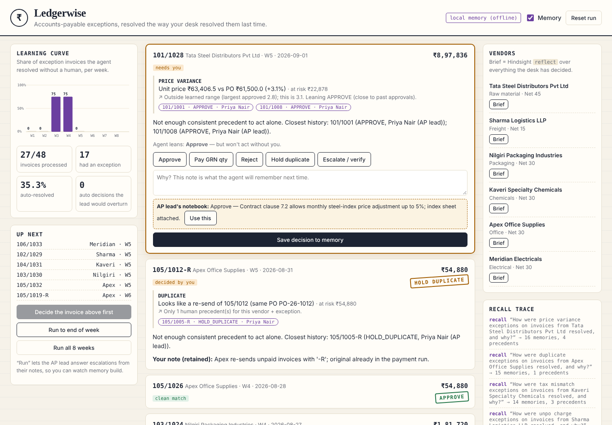
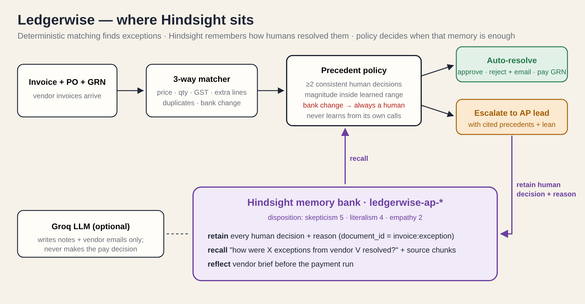

# Ledgerwise — an AP exception agent that remembers how your desk decided

Every accounts-payable desk relearns the same vendor quirks every month.
Tata Steel's price is 3% over PO again (the steel-index clause allows it).
Sharma Logistics added a fuel surcharge again (fine under ₹2,500, not above).
Kaveri billed 18% GST on a 12% line again (always reject, ask for a credit note).
The person who knows all this is the AP lead, and every one of these lands on their desk.

**Ledgerwise** is an agent that sits after the 3-way match. For every exception it **recalls** how
the same vendor's same exception was resolved before, resolves it automatically when human
precedent is consistent, and otherwise escalates *with the precedents attached*. Every human
decision — and the reason typed with it — is **retained** in [Hindsight](https://github.com/vectorize-io/hindsight),
so the next invoice is easier.



## What memory changes (8 weeks, 6 vendors, 48 invoices, 32 exceptions)

| | Week 1 | Week 2 | Week 3 | Week 4 | Week 5 | Week 6 | Week 7 | Week 8 | Overall | Wrong auto calls |
|---|---|---|---|---|---|---|---|---|---|---|
| Without memory | 0% | 0% | 0% | 0% | 0% | 0% | 0% | 0% | **0%** | 0 |
| With memory | 0% | 0% | 75% | 75% | 60% | 60% | 100% | 67% | **56%** | **0** |

Percent = exception invoices resolved without a human. "Wrong" = an automatic decision the AP lead
would have overturned. Reproduce with `python scripts/replay.py` (numbers above are from the bundled
dataset; run it against your Hindsight bank to get yours).

The dips are deliberate and are the most interesting part:

* **Week 5, Tata Steel at +3.1%** — humans had only approved up to +2.8%, so the agent escalates
  ("outside learned range, leaning approve") instead of extrapolating.
* **Week 6, Sharma surcharge ₹6,800** — every past approval was ≤ ₹2,400. Escalated, the lead
  rejects, and that rejection becomes the upper bound.
* **Week 6, Meridian's "new bank account" letter** — escalated no matter what memory says. A changed
  remit-to account is the classic invoice-fraud pattern.

## How Hindsight is used

See [HINDSIGHT.md](HINDSIGHT.md) for the full write-up. In short:

| Operation | Where | What |
|---|---|---|
| `create_bank` | `memory.py` | One bank per AP desk, with a mission and a *skeptical, literal* disposition (an AP desk should not generalise one approval). |
| `retain` | `agent.py → retain_decision` | Every human decision on every exception: vendor, exception type, magnitude, decision, who decided, and the free-text reason. `document_id = invoice:exception`, timestamped with the invoice date. |
| `recall` | `agent.py → recall_precedents` | Before deciding: *"How were price variance exceptions on invoices from Tata Steel resolved, and why?"* — with `include_chunks=True` so the structured precedent line comes back with the facts. |
| `reflect` | `agent.py → vendor_brief` | "Brief" button: what an AP clerk should know about this vendor before the payment run. |

## Guardrails memory can't override

1. **Bank-account changes always go to a human** for a call-back check.
2. **Only human decisions are precedent.** The agent's own auto-decisions are retained for audit but
   never counted — it can't drift by agreeing with itself.
3. **No extrapolation.** A magnitude more than 10% above anything a human approved is escalated.
4. **Disagreement resets trust.** If the last three human calls on a vendor+exception disagree, it escalates.
5. **The LLM never decides.** Groq (`openai/gpt-oss-120b`) only writes the explanation and vendor
   emails; if it is unavailable a template is used and nothing blocks.



## Run it

```bash
git clone https://github.com/SomeswararaoTellakula/ledgerwise && cd ledgerwise
python -m venv .venv && source .venv/bin/activate
pip install -r requirements.txt
cp .env.example .env      # add HINDSIGHT_URL (+ HINDSIGHT_API_KEY for Hindsight Cloud), optional GROQ_API_KEY
python app.py             # http://localhost:5050
```

Hindsight options: [Hindsight Cloud](https://ui.hindsight.vectorize.io) (paste the API URL and key into
`.env`), or local Docker:

```bash
docker run --rm -it -p 8888:8888 -p 9999:9999 \
  -e HINDSIGHT_API_LLM_API_KEY=$OPENAI_API_KEY -e HINDSIGHT_API_LLM_MODEL=gpt-4o-mini \
  -v $HOME/.hindsight-docker:/home/hindsight/.pg0 ghcr.io/vectorize-io/hindsight:latest
# then HINDSIGHT_URL=http://localhost:8888  (other LLM providers, e.g. Groq: see Hindsight's configuration docs)
```

Without `HINDSIGHT_URL` the app falls back to a tiny local keyword store so tests run offline; the header
badge shows which backend is live. The demo is meant to be run on Hindsight.

### Demo flow (≈ 3 minutes)

1. Untick **Memory** → **Run all 8 weeks**: 0% automation, every exception lands on you.
2. Tick **Memory** → **Process next invoice** a few times in week 1: decide each one, type a reason. That reason is what gets retained.
3. **Run to end of week** through week 4 and watch the curve jump to 75%, with precedent chips on every auto decision.
4. Step through week 5: Tata at +3.1% escalates with "leaning approve" — approve it and the learned range widens.
5. Week 6: the Meridian bank-change letter is held regardless of history. Sharma's ₹6,800 surcharge escalates.
6. Click **Brief** on any vendor → Hindsight `reflect` summarises everything the desk has learned.

## Layout

```
app.py                  Flask app + JSON API
ledgerwise/matching.py  deterministic 3-way match (no memory, no LLM)
ledgerwise/agent.py     recall → precedent policy → auto/escalate → retain
ledgerwise/memory.py    Hindsight backend + offline fallback, precedent format/parser
ledgerwise/llm.py       Groq narration (optional, never decides)
ledgerwise/sim.py       week-by-week replay, scoring, stats
ledgerwise/data_gen.py  deterministic synthetic AP data (6 vendors, 8 weeks)
scripts/replay.py       with/without-memory comparison from the CLI
tests/                  pytest: matcher, policy, guardrails, learning curve
content/                article, social post, video script, submission notes
```

## Tests

```bash
pytest -q   # 8 tests: quirk detection, 0% without memory, 0 wrong auto decisions,
            # bank-change guardrail, no self-learning, out-of-range escalation, disagreement reset
```

## Data

All vendors, GSTINs, POs, GRNs and invoices are synthetic and generated deterministically by
`ledgerwise/data_gen.py`. Each vendor has one realistic recurring quirk; `truth` on each invoice plays
the AP lead and is never read by the agent.

## Author

Someswara Rao Tellakula — [github.com/SomeswararaoTellakula](https://github.com/SomeswararaoTellakula)

MIT licensed.
