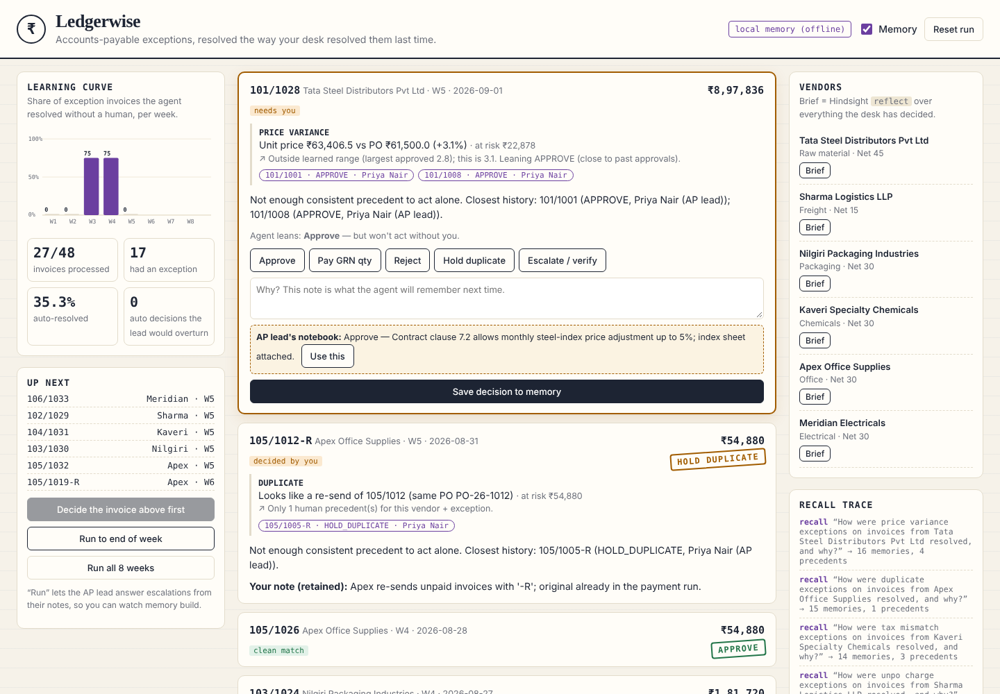
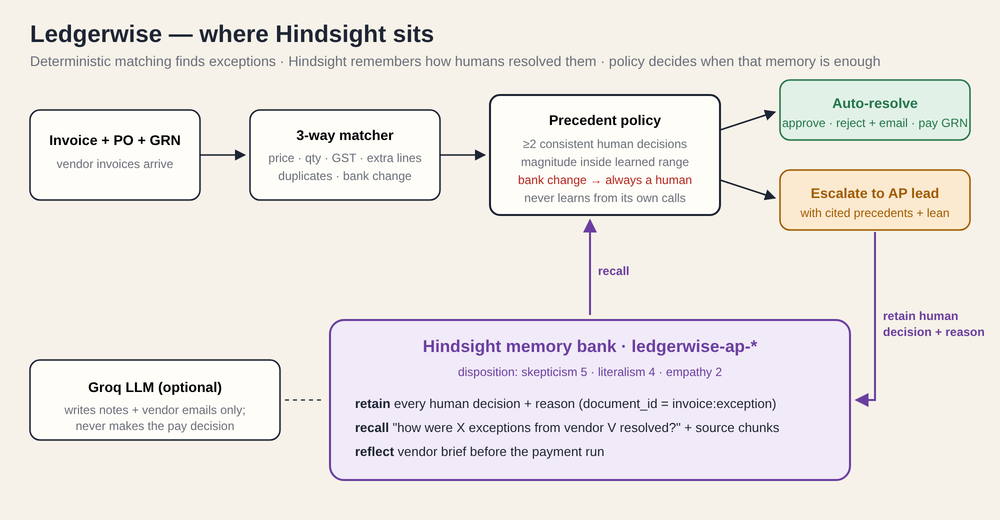
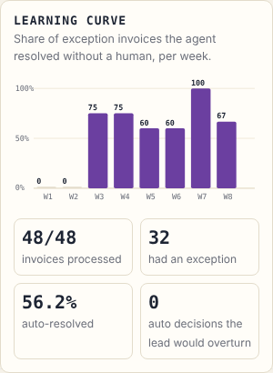
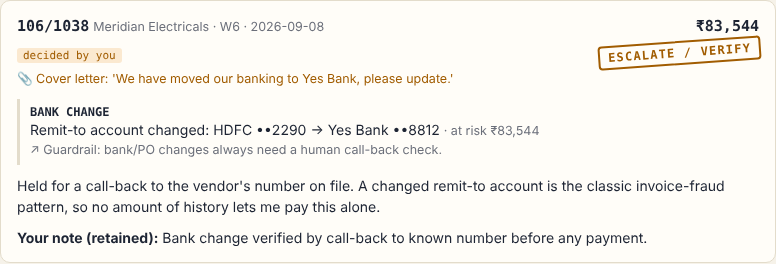

# I Gave My Accounts-Payable Agent Hindsight Memory. It Stopped Asking.

Every month, an invoice from a steel distributor arrives priced 3% above the purchase order, and every month someone in accounts payable stops, opens the contract, finds clause 7.2 (monthly steel-index adjustment, capped at 5%), and approves it. The matching software flags it perfectly. It just has no idea that this exact question was answered last month, and the month before.

That is the gap I built Ledgerwise for: an agent that sits after the 3-way match and resolves invoice exceptions the way *your* desk resolved them last time — and knows when that history isn't enough.



## What the system does

An AP desk matches three documents: the purchase order (what we agreed to buy), the goods receipt (what actually arrived), and the invoice (what the vendor wants paid). When they disagree you get an exception: a price variance, a short shipment, a GST rate that doesn't match the contract, a surcharge line nobody ordered, a re-sent duplicate, or a vendor letter saying "we've changed our bank account."

Detecting those is a solved problem, and in Ledgerwise it's deliberately boring: `matching.py` is deterministic Python with no model and no memory. It finds exceptions and measures them — a percentage for price, rupees for a surcharge, units for a short shipment.

The interesting part is deciding. That's `agent.py`, and it runs one loop per exception:

1. **Recall** how this vendor's same kind of exception was resolved before.
2. Apply a conservative **precedent policy**.
3. **Auto-resolve** if human precedent is consistent; otherwise **escalate** with the precedents attached.
4. **Retain** every human decision, including the reason they typed, so the next one is easier.

The memory layer is [Hindsight](https://github.com/vectorize-io/hindsight), an open-source agent memory system from Vectorize. I picked it over rolling my own vector store because AP history isn't a pile of documents to search — it's a set of decisions with actors, amounts and dates, and I wanted something that extracts and organises those facts rather than just embedding paragraphs.



## The core story: memory is only useful if you know when not to trust it

The obvious design is: recall similar past decisions, and if the top result says APPROVE, approve. Run that against the replay data and it looks great for a few weeks — until a logistics vendor sends a ₹6,800 fuel surcharge. Every earlier surcharge from that vendor was approved, but they were ₹1,200–₹2,400, and the agreed cap is ₹2,500. Similarity says "same vendor, same exception, approved." The money says otherwise.

That case reshaped the whole design. The question stopped being "what does memory say?" and became "is memory *enough* here?"

### Writing memories the policy can actually use

Each human decision is retained as one string with two parts: a prose sentence that [Hindsight's retain pipeline](https://hindsight.vectorize.io/) extracts facts and entities from, and a structured line my policy can parse back out.

```python
def retain_decision(self, invoice, exc, decision, reason, decided_by):
    vendor = self.vendors[invoice["vendor_id"]]
    self.memory.retain(
        precedent_text(vendor, exc["type"], exc["magnitude"], decision,
                       invoice["id"], decided_by, reason),
        context=f"accounts payable exception resolution — {vendor['category'].lower()} vendor",
        document_id=f"{invoice['id']}:{exc['type']}",
        metadata={"vendor_id": vendor["id"], "exception": exc["type"],
                  "decision": decision, "decided_by": decided_by},
        timestamp=invoice["date"],
    )
```

`document_id` keeps a re-decision on the same invoice from becoming a duplicate memory, and `timestamp` uses the invoice date rather than "now", so temporal questions work.

The magnitude matters as much as the decision. "Approved a 2.8% variance" and "approved a 4.2% variance" are different precedents.

### Recalling with the source attached

Before touching an exception, the agent asks a question in plain English:

```python
query = (f"How were {exc.type.replace('_', ' ').lower()} exceptions on invoices from "
         f"{vendor['name']} resolved, and why?")
resp = client.recall(bank_id=self.bank_id, query=query,
                     types=["world", "experience", "observation"],
                     budget="mid", max_tokens=4096,
                     include_chunks=True, max_chunk_tokens=600)
```

`include_chunks=True` was the detail that made this work. Recall returns the extracted facts, which are great for humans and for reflection, but the policy needs exact numbers. Asking for source chunks brings the structured precedent line back alongside each fact.

### The policy

With precedents in hand, the rules are short and intentionally conservative:

```python
if len(approved) >= MIN_PRECEDENTS and exc.magnitude <= cap and (floor is None or exc.magnitude < floor):
    return ExceptionDecision(exc.to_dict(), "APPROVE", True,
        f"{len(approved)} human approvals up to {max(approved):g}; this is {exc.magnitude:g}.", cited)
```

- At least **two human precedents** before acting.
- For amounts: approve only **inside the range humans approved** (plus 10% headroom) and below anything they rejected. Outside that range, escalate with a lean — "close to past approvals" or "far from anything approved".
- For categorical exceptions (short shipment, GST mismatch, duplicate): act only if the **last three human decisions agree**.
- **Bank-account changes always go to a human.** No amount of history makes a changed remit-to account safe to pay automatically.
- **The agent never learns from itself.** Its own decisions are retained for audit, but tagged and excluded from precedent. Without that, one bad call becomes two precedents by Thursday.

The LLM (Groq, `openai/gpt-oss-120b`) writes the explanation and the vendor email. It never makes the pay/no-pay decision, and if it's down, a template takes over.

## What it looks like over eight weeks

I replay eight weeks of invoices from six vendors, each with one realistic recurring quirk, and play the AP lead whenever the agent escalates.

| | W1 | W2 | W3 | W4 | W5 | W6 | W7 | W8 | Overall |
|---|---|---|---|---|---|---|---|---|---|
| Without memory | 0% | 0% | 0% | 0% | 0% | 0% | 0% | 0% | 0% |
| With Hindsight | 0% | 0% | 75% | 75% | 60% | 60% | 100% | 67% | 56% |

That's the share of exception invoices resolved with no human, on the replay dataset. Across the run, zero of the automatic decisions were ones the AP lead would have overturned.



The dips are the part I'm proudest of:

**Week 1, Kaveri invoices 18% GST on a 12% line.** No memory, so it comes to me. I reject and type: *"HSN 2839 is contracted at 12% GST; ask Kaveri for a credit note. Never pay the 18% version."*

**Week 3, same quirk.** Recall returns two human rejections. The agent rejects on its own, cites both invoice numbers, and drafts the credit-note email. Nobody touches it.

**Week 5, steel at +3.1%.** Humans had approved up to +2.8%. The agent escalates with "leaning approve" instead of extrapolating. I approve, and the learned range widens.

**Week 6, Meridian Electricals sends a "we've moved banks" letter.** Memory has six clean Meridian invoices. It escalates anyway.



The "Brief" button calls Hindsight's `reflect` for a vendor and returns what a new joiner should know before the payment run: fuel surcharges up to ₹2,500 are pre-agreed, one at ₹6,800 was rejected. That's the institutional knowledge that usually leaves when the AP lead goes on leave.

## Lessons

**1. The reason field is the product.** I made the UI refuse to save a decision without a typed reason. Those sentences are what escalations show, what `reflect` summarises, and what makes the memory auditable. "Approved" is a log line; "approved under clause 7.2, index sheet attached" is knowledge.

**2. Store the magnitude, not just the outcome.** Similarity search will happily match "same vendor, same exception" and ignore that this one is three times bigger. Every precedent carries its number, and the policy compares numbers.

**3. Decide what memory is allowed to override before you write any recall code.** Bank changes, unknown POs and anything outside a learned range are human-only by design. Writing those guardrails first made the rest of the policy much easier to reason about.

**4. Don't let the agent cite itself.** Retaining the agent's own decisions is useful for audit and reflection. Counting them as precedent is how a system drifts.

**5. Make memory configurable, not magical.** A skeptical, literal bank disposition (skepticism 5, literalism 4) fit an AP desk better than the defaults. One approval of a 3% variance should not become permission for "price variances" in general.

The honest limitation: Ledgerwise is only as good as the reasons people type. A desk that clicks "approve" with "ok" gets an agent that can count but can't explain.

If you want to try the memory layer yourself, the [Hindsight docs](https://hindsight.vectorize.io/) get you to a working retain/recall loop quickly, and Vectorize's explainer on [what agent memory is](https://vectorize.io/what-is-agent-memory) is a good read on why this is different from RAG. Ledgerwise's code is on GitHub: https://github.com/SomeswararaoTellakula/ledgerwise
